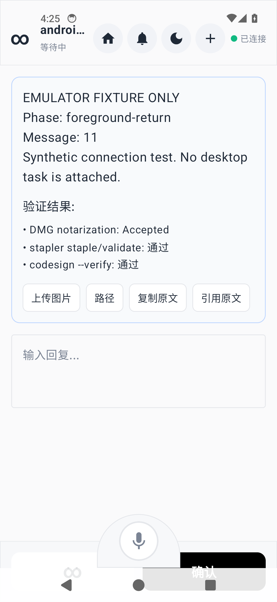

# Android emulator connection receipt

Date: 2026-09-11. Production application source: unchanged from public main
`94deae14155c2e5b2178d5bcbdfc1293cde55026`. The working branch also contained the
documentation-only plan commit `6f2cc890aac4d036db7cca41f63f9e9343f93b2b`.

## Result

**The existing Android app built and ran. A single WebSocket remained responsive
for approximately 5 minutes, including 3 minutes with the launcher foregrounded.
Recovery after server-initiated close did not pass.**

| Check | Observation |
| --- | --- |
| `:app:testDebugUnitTest` | PASS: 6 tests, zero failures/errors; parser 3, voice helper 3 |
| `:app:assembleDebug` | PASS; installed successfully |
| Connection | One Android handshake and `client_hello` observed |
| Foreground heartbeat | 2 Ping/Pong exchanges |
| Background heartbeat | 6 Ping/Pong exchanges over 180 seconds; same connection |
| Return to foreground | 2 more Ping/Pong exchanges; new synthetic request rendered |
| Automatic recovery | FAIL: no new connection within 60 seconds after controlled close |
| UI after disconnect | FAIL: still displayed `已连接` after transport closure |

These tests do not verify secure pairing, a real desktop task, Relay delivery,
reply processing, notification display, Doze, screen-off overnight behavior,
physical OEM devices or Android 15/16 runtime restrictions.

## Environment and isolation

- Emulator: existing API 34 AOSP/default arm64 image, Pixel 5 profile; emulator
  37.1.11.0, headless, read-only overlay, no snapshot save.
- JDK 17.0.9, repository Gradle wrapper 8.14.3.
- APK SHA-256: `9366a4bdc360220b7b2cf52d59c989f266af1349c24d3403f06d0645bc54cf98`.
- Application defaults were not edited. `adb reverse tcp:8080 tcp:18080` routed
  emulator-local loopback to a separate host-loopback fixture.
- Fixture used Node.js with `ws` 8.x, `/api/version`, `/ws`, one synthetic request
  on connect and every 30 seconds, server Ping every 30 seconds, and Pong logging.
- No real Bridge authentication was disabled; no real account, task or device
  credential was used. The forwarding did not point at the production Bridge.
- Initial online dependency acquisition was interrupted once; offline retry
  showed missing cached dependencies. The final online build completed successfully
  in 2m19s. Existing deprecation warnings remain; no build fixes were made.

## Timeline (UTC)

| Time | Event |
| --- | --- |
| 08:20:55.039 | WebSocket connection 1 opened |
| 08:22:01.634 | Background phase began; launcher verified as resumed activity |
| 08:25:01.676 | Returned to foreground after 180 seconds |
| 08:26:06.927 | Fixture sent Close 1012 and remained available for a new handshake |
| 08:26:36.933 | Fixture recorded closure 1006 after the close handshake timed out |
| After the 60-second observation | Still one total connection, none open; UI still said connected |

The 30-second close-handshake timeout is a fixture/runtime detail, not a claimed
production timeout. Ten Pings received ten matching Pongs before closure. The
server sent fourteen synthetic requests; the UI evidence confirms rendering at
selected checkpoints, not a per-message business acknowledgement for all fourteen.

Raw evidence: [event log](events.jsonl) and [before/after counters](result.json).
Elapsed times in the event log start at fixture startup, approximately five minutes
before the application was launched; they must not be counted as connected time.

## Screenshots

The text under the synthetic request mentioning DMG notarization, stapler and
codesign is pre-existing static placeholder UI in `WorkbenchComponents.kt`.
It is **not** a result of this Android experiment or a real desktop message.

Returned to foreground: synthetic request 11 is rendered after the background
interval, and the transport was still responsive.



After disconnect: synthetic request 14 remains visible and the status incorrectly
still says `已连接`, while the fixture has no open connection.


## Implementation implications

`BridgeClient.requests()` reports `onFailure` but has no closing/closed state
handling in this baseline. `BridgeViewModel.connect()` collects one flow without
a reconnect loop. These are source explanations consistent with the measured
missing recovery; this run does not isolate every possible failure callback.

The next implementation should first make socket closure update UI truthfully,
then add a single-owner reconnect state machine. Repeat this fixture test as a
regression check before adding foreground service and provider notifications.
The larger sequence is in the [implementation plan](../../android-background-messaging-plan.md).

## Reproduction outline

1. Check out the pinned application baseline and run the two Gradle tasks above.
2. Launch an isolated API 34 emulator overlay and install `app-debug.apk`.
3. Start a loopback-only fixture providing a successful version response and `/ws`.
4. Forward emulator port 8080 to fixture port 18080 using `adb reverse`.
5. Send frames shaped as shown below; log handshake, Ping/Pong and closes.
6. Launch `.MainActivity`; observe 60 seconds, foreground the launcher for 180
   seconds, return to the app for 60 seconds, then send Close 1012 and observe
   another 60 seconds. UI capture adds a few seconds between checkpoints.
7. Remove forwarding, stop the fixture and close the temporary emulator overlay.

```json
{
  "message_type": "mcp_state",
  "payload": {
    "request": {
      "request_id": "fixture-1",
      "project_path": "/fixture/android-connection-test",
      "message": "EMULATOR FIXTURE ONLY — synthetic connection test",
      "predefined_options": []
    }
  }
}
```
