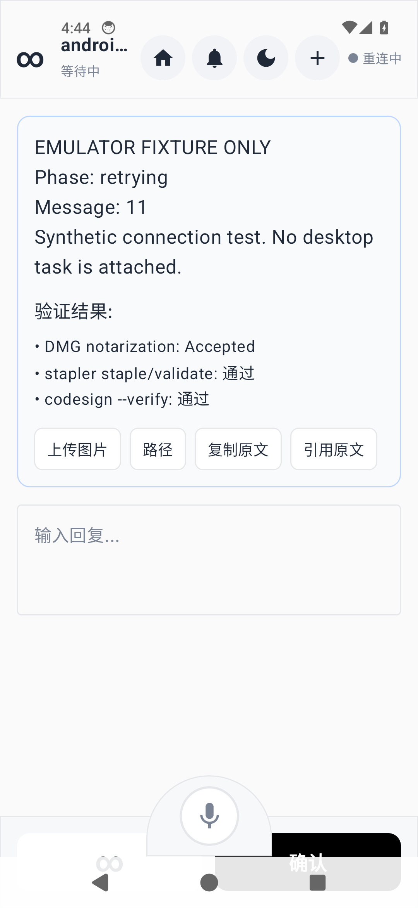

# Android WebSocket recovery receipt

Date: 2026-09-11. Tested application commit: `32f2fcba3f402c17a431a7e11e571ae9dc1950ea`.
Baseline failure and wider plan: [PR #6](https://github.com/co-iterate/iterate-android/pull/6).

## Result

**PASS for the scoped synthetic emulator recovery test.**

| Check | Observation |
| --- | --- |
| JVM tests | 15 passed, no failures/errors: 9 connection, 3 parser, 3 voice helper |
| Debug APK | Built and installed successfully |
| Foreground | One connection, 2 matching Ping/Pong exchanges |
| Background | Same connection for 180 seconds; 6 additional matching Ping/Pong exchanges |
| Close handshake | Server Close 1012 acknowledged immediately; recorded closure 1012 |
| Service unavailable | 9 HTTP 503 handshake rejections over approximately 40 seconds; UI showed 重连中 |
| Service restored | New connection after 12.506 seconds, with client_hello and request_sync |
| Recovered UI | 已连接 and new synthetic request 13 visible; new connection responded to heartbeat |

The measured recovery delay is one jittered-backoff sample, not an SLA.

## Environment

API 34 AOSP/default arm64 emulator, Pixel 5 profile, read-only headless overlay.
JDK 17 and repository Gradle wrapper. Build command:

```sh
./gradlew --offline --no-daemon --max-workers=2 :app:testDebugUnitTest :app:assembleDebug
```

APK SHA-256: `dddf42aa7412567f7dec667376657f2a8cba25ddc64ad7d2cb354afb435aad6b`.
The unmodified default emulator-local port 8080 was forwarded to an isolated
host-loopback Node/ws fixture on port 18081. No production authentication,
account, credential or desktop task was used.

## Timeline (UTC)

- 08:40:05.873: first WebSocket opened; client_hello and request_sync received.
- After 60 seconds foreground: launcher foregrounded for 180 seconds; launcher
  was verified as the resumed Activity.
- 08:44:12.427: old connection closed with 1012; fixture rejects new handshakes.
- Approximately 8 seconds later: screenshot confirms 重连中.
- 08:44:52.627: fixture resumes accepting connections.
- 08:45:05.133: second connection opens; hello/sync received again.
- After 60 seconds of recovery observation: screenshot confirms new request and
  已连接. The second connection has one matching Ping/Pong at the recorded snapshot.

Raw evidence: [events](events.jsonl), [counters and assertions](result.json).
The event log was copied at completion; counters in result.json are the runner's
slightly earlier final snapshot. Elapsed event time starts at fixture startup,
not application connection.

## Visual checks

Screenshots were also inspected manually. The DMG notarization/stapler/codesign
text is pre-existing static placeholder UI in WorkbenchComponents.kt, **not a
result of this test**. Only the synthetic request and connection status are relevant.




## Reproduction and scope

Use a loopback WebSocket fixture at /ws that logs hello/sync and sends synthetic
mcp_state requests, with server Ping every 30 seconds. Observe 60 seconds in the
foreground and 180 seconds with the launcher foregrounded. Return to the app,
send Close 1012 and reject upgrades with HTTP 503 for about 40 seconds, then
accept connections again and observe for 60 seconds. Capture UI during the
outage and after recovery. The automated JVM tests in
BridgeClientConnectionTest provide repeatable coverage for the failure cases.

This verifies connection recovery and selected rendering checkpoints only.
It does not verify production Bridge pairing, real task/reply delivery, durable
business acknowledgements, notifications, foreground services, Doze, overnight
screen-off behavior, physical OEM devices or Android 15/16 restrictions.
